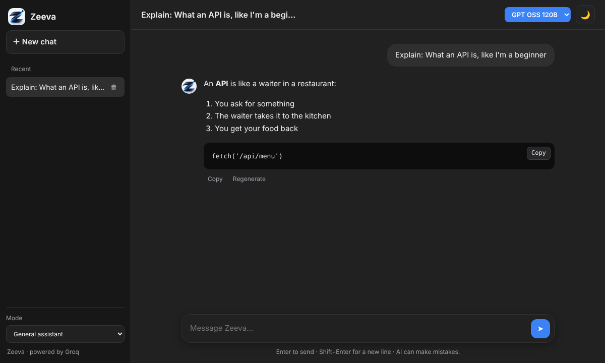

<p align="center"></p>

# Zeeva

[](https://github.com/vishnurdev/ai-chat-app/actions/workflows/tests.yml)


**A fast, clean AI chatbot that streams answers in real time — powered by open models on [Groq](https://groq.com) and deployed on Vercel.**

🔗 **Live demo:** _coming soon_



## Features

- ⚡ **Real-time streaming** replies, with a Stop button
- 🧠 **Live model list**: automatically shows every chat model your Groq key can use
- 🎭 **Modes**: General assistant, Code helper, Writing assistant, Explain simply
- 📝 **Markdown** answers with code blocks and one-click **Copy**
- 🔁 **Regenerate** the last answer, start a **New chat** anytime
- 🗂️ **Chat history sidebar**: switch between chats, delete old ones
- 🌗 **Day / night mode** button (remembers your choice), works great on **mobile**
- 🔒 API key stays on the server, input is validated, and AI output is HTML-escaped (no script injection)
- 📦 **Zero dependencies** — no build step, no `npm install`

## How it works

```
Browser (index.html + app.js)
   │  POST /api/chat  { model, persona, messages }
   ▼
Vercel Edge Function (api/chat.js)
   │  adds system prompt + secret GROQ_API_KEY
   ▼
Groq API  ──streams tokens──►  Edge Function  ──plain text stream──►  Browser
```

## Run it locally

You need **Node.js 18+** and a free Groq API key from [console.groq.com/keys](https://console.groq.com/keys).

```bash
git clone https://github.com/vishnurdev/ai-chat-app.git
cd ai-chat-app
cp .env.example .env        # then paste your key into .env
node server.js
```

Open **http://localhost:3000**.

## Deploy your own (free)

[](https://vercel.com/new/clone?repository-url=https://github.com/vishnurdev/ai-chat-app&env=GROQ_API_KEY&envDescription=Your%20Groq%20API%20key&envLink=https://console.groq.com/keys)

1. Click the button above (or import the repo in Vercel).
2. Add the environment variable `GROQ_API_KEY`.
3. Deploy. That's it.

## Project structure

```
├── index.html          # page layout
├── style.css           # styling (dark/light, responsive)
├── app.js              # chat UI, streaming, history
├── markdown.js         # tiny safe Markdown renderer
├── api/chat.js         # Vercel Edge Function → Groq
├── server.js           # local dev server (no dependencies)
└── tests/              # node:test suite (runs in CI on Node 18/20/22)
```

## Tests

```bash
npm test
```

Covers request validation, streaming (including events split across network chunks), error handling, and Markdown safety.

## Customise

- **Add a mode:** add an entry to `PERSONAS` in `api/chat.js`.
- **Models:** loaded live from Groq; `MODELS` in `api/chat.js` is only the fallback.
- **Name:** change `APP_NAME` at the top of `app.js`.
- **Colours:** edit the theme tokens at the top of `style.css`.

## Need a chatbot for your business?

I build custom AI assistants, Discord bots and automation tools. Reach out via my [GitHub profile](https://github.com/vishnurdev).

## License

MIT
